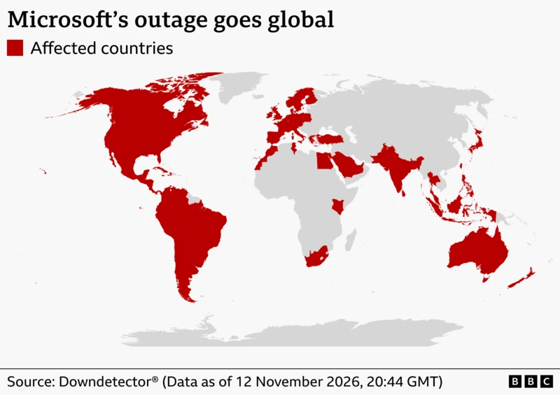
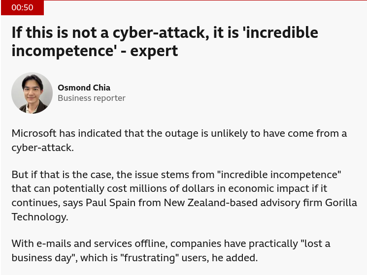

# O ataque à APS e a queda da Microsoft

Neste vídeo nós estamos comentando ao vivo as repercussões e o que se sabe até o momento sobre o ataque ao Porto de Santos e a queda dos serviços da Microsoft.

**Veja também no canal:**
{{#embed https://youtube.com/watch?v=15WOv_Qoppc}}

### Ataque cibernético à APS e Porto de Santos

[https://www.cnnbrasil.com.br/infra/sistemas-do-porto-de-santos-devem-ser-retomados-ate-sexta-feira-diz-pomini/](https://www.cnnbrasil.com.br/infra/sistemas-do-porto-de-santos-devem-ser-retomados-ate-sexta-feira-diz-pomini/ (preview))

[https://www.metropoles.com/sao-paulo/porto-de-santos-confirma-ter-recebido-pedido-de-resgate-apos-ataque-hacker](https://www.metropoles.com/sao-paulo/porto-de-santos-confirma-ter-recebido-pedido-de-resgate-apos-ataque-hacker (preview))

- Funcionários voltaram a trabalhar ‘analógicamente’ com papel e consultando sistemas do governo federal
- Foi um ataque ou não? Foi um ransomware? A recuperação de becapes sugere que sim. Um grupo assumindo o ataque pode ser ou não
- Vazaram dados ou não? Tem logs?
- Se foi um ataque qual o objetivo? O aumento do nível de segurança
- Acontecer depois da queda de energia é bem suspeito, parece filme slk. Mr. Robot total

#### Referências sobre ransomware:

- Ataque de Ransonware ao STJ: <https://pt.wikipedia.org/wiki/Ataque_cibern%C3%A9tico_ao_Superior_Tribunal_de_Justi%C3%A7a>
- Ataque de Ransomware às lojas Renner: <https://tecnoblog.net/noticias/renner-explica-impactos-do-ataque-de-ransomware-a-pedido-do-procon-sp/>
- Ataques ransomware no Brasil: <https://ransomnews.com/ransomware-attacks/brazil/>
- Ataques de ransomware por setor <https://www.computerweekly.com/br/noticias/366654636/Brasil-o-4-pais-do-mundo-com-mais-ataques-de-ransomware>
- Estatísticas da ANPD <https://www.gov.br/anpd/pt-br/assuntos/fiscalizacao/resultados-da-fiscalizacao?utm_source=chatgpt.com>

### Office 365, Outlook, Teams, Copilot cairam

[https://www.bbc.com/news/live/cq5y10ge3dp3t?page=6](https://www.bbc.com/news/live/cq5y10ge3dp3t?page=6 (preview))

[https://g1.globo.com/tecnologia/noticia/2026/11/13/microsoft-tem-dificuldades-para-solucionar-falha-que-deixa-outlook-fora-do-ar-e-afeta-outros-servicos-o-que-se-sabe.ghtml](https://g1.globo.com/tecnologia/noticia/2026/11/13/microsoft-tem-dificuldades-para-solucionar-falha-que-deixa-outlook-fora-do-ar-e-afeta-outros-servicos-o-que-se-sabe.ghtml (preview))

>  A Microsoft negou que a falha em seus serviços seja provocada por um ataque cibernético e atribuiu o problema à "sobrecarga elevada" em sua infraestrutura. 
>
> …
>
> No caso da falha da Microsoft, um grande número de servidores ficou "indisponível inesperadamente", segundo a empresa, o que sobrecarregou os servidores restantes. 

- Em alguns países tivemos empresas que basicamente perderam um dia de trabalho

#### O que causou? Post Mortem não oficial

[https://controlplane.com/blog/post/microsoft-365-outage-november-2026-cause](https://controlplane.com/blog/post/microsoft-365-outage-november-2026-cause (preview))
