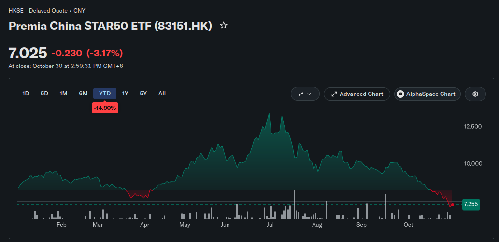
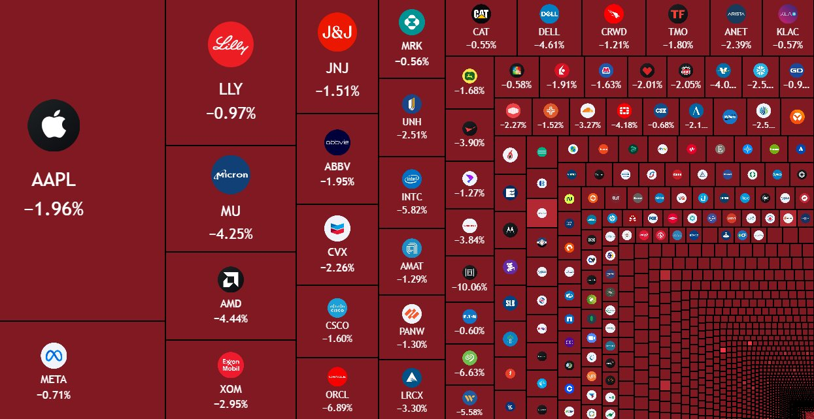

# A bolha da IA estourou?

Pra ser bem sincero, ainda não podemos ter certeza, mas nesse vídeo vamos explicar os fundamentos mais básicos de por que é uma bolha e dar pra vocês a habilidade de entender o que se comenta por ai.

**Veja também no canal:**
{{#embed https://youtube.com/watch?v=76ZwjPwvWXs}}

- Nos últimos dias alguns eventos tem deixado “o mercado” com medo e isso derrubou as bolsas do mundo todo:
  - Quebra de expectativas após relatórios de ‘quarter’ das big techs
  - Dúvidas sobre as valorações de Anthropic e OpenAI em seus possíveis IPOs
  - Aumento das despesas de capital (capex) nos balanços das empresas
  - Ausência de retorno dos investimentos em IA, ao mesmo tempo que o setor está engolindo todos modelos de negócio anteriores  

- Exemplo da Google (Alphabet) que sofreu uma desvalorização de U$500bi:
  - Crescimento no setor de buscas (fonte principal de renda) é morno
  - Investimento em data centers (compute) cada vez maior
  - Grande parte do crescimento da empresa vem da valorização de ações que eles tem da Anthropic (que é a maior cliente para o seu compute)
  - Ou seja, nos últimos anos a Google rifou sua principal fonte de renda e agora todo o seu crescimento é puxado pela promessa de hipercrescimento do setor de IA
  - Hoje o crescimento da Google depende de uma valoração extraordinária do IPO da Anthropic

[https://epocanegocios.globo.com/empresas/noticia/2026/10/alphabet-dona-do-google-enfrenta-perda-de-us-500-bilhoes-em-valor-de-mercado-apos-balanco.ghtml](https://epocanegocios.globo.com/empresas/noticia/2026/10/alphabet-dona-do-google-enfrenta-perda-de-us-500-bilhoes-em-valor-de-mercado-apos-balanco.ghtml (preview))

- E ao publicar sua proposta de oferta pública a Anthropic inicialmente tinha omitido os valores de seus compromissos futuros com compute (contratos por data center já fechados) e esse custo se aproxima de U$900bi

[https://www.ft.com/content/4d91dbab-6fe4-45ab-beee-d77e091cb37f?syn-25a6b1a6=1](https://www.ft.com/content/4d91dbab-6fe4-45ab-beee-d77e091cb37f?syn-25a6b1a6=1 (preview))

- Talvez estejamos no meio desse estouro e **não saibamos ainda**. Então o objetivo aqui vai ser fazer um vídeo mais didático sobre a dinâmica da bolha econômica, para que vocês consigam interpretar as notícias e entender os próximos dias.

- Primeiro teve o “estouro da bolha” na China que foi uma desvalorização consistente desde o pico em Julho com uma perda de U$480bi:

- Os motivos dessa desvalorização são:
  - Empresas avaliadas muito acima do que seus retornos sugerem e ceticismo sobre lucros futuros
  - Dúvidas sobre a real demanda por IA, chips e infra
  - Possíveis restrições de exportação dos EUA
  - Um mercado de investidores sardinha com comportamento especulativo

- E daí chegamos no Halloween (dos EUA) e no dia dos Finados daqui e temos isso acontecendo nas bolsas dos EUA:

[https://x.com/macropaperr/status/2117313130464493615/photo/1](https://x.com/macropaperr/status/2117313130464493615/photo/1 (preview))

- Vamos para o diagrama:

[https://excalidraw.com/#json=lI76Wv3RupswHNS4apJIR,_In464Tcx1Y5zOtWzZ1EEg](https://excalidraw.com/#json=lI76Wv3RupswHNS4apJIR,_In464Tcx1Y5zOtWzZ1EEg (preview))

- Em resumo:
  - Um setor de SaaS com dificuldade de lucrar extraordinariamente, com margens pressionadas e muita competição
  - Investimentos e compromissos de pagamentos de infraestrutura sustentados em dívidas e financiamento circular
  - Os maiores players como Anthropic e OpenAI subsidiando o custo dos tokens e dependendo de investimento quase infinito e contabilidade criativa para mostrar lucros
  - O modelo de negócio real das empresas, “a economia real”, sendo deixada para trás enquanto as big techs focam tudo em capex e financiamento circular
  - Os IPOs representando ‘liquidez de saída’ para os investidores originais da Anthropic. Deixando a bomba na mão do investidor sardinha

- Vai explodir? Já explodiu? Vamos descobrir se essa tendência continuar acontecendo.
  - Temos hoje a eleição de meio de mandato nos EUA e provavelmente muita coisa está ‘pausada’ até os próximos dias
  - Vendo relatos da bolha .com uma coisa que chamou a atenção é que só foi possível ver em retrospecto o momento que estourou tudo. Então fiquemos no aguardo
