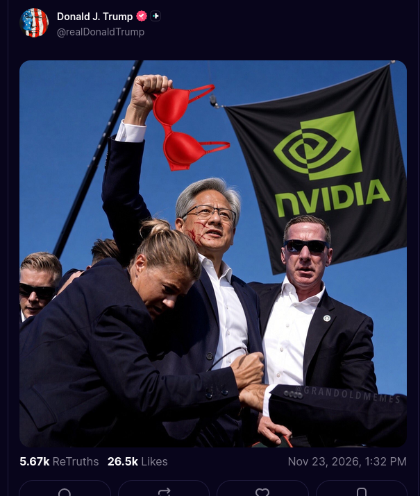

# Jensen Huang voltou

Depois de um curto período de férias de 11 dias, Jensen Huang, o CEO da NVIDIA retorna ao seu cargo. O que aconteceu? Sr. Tecnologia e Jaqueta de Couro aqui pra explicar

**Veja também no canal:**

{{#embed https://youtube.com/watch?v=BJVnF8eDXJ8}}

- Se quiserem entender a saga de Jensen Huang temos 2 vídeos:

{{#embed https://youtube.com/watch?v=VOeGDa9jHPA}}

{{#embed https://youtube.com/watch?v=B2jsGVkiDsE}}

- Mas em resumo:
  - No final de Out/26 o CEO da NVIDIA Jensen Huang é acusado em matéria do NYT de manter um relacionamento extraconjugal com um suposta espiã chinesa chamada Alice Huang (sem parentesco)
  - A NVIDIA estaria implicada num esquema de contrabando de placas de vídeo para a China (modelos de venda proibida para a China pelo governo dos EUA)
  - Ações da NVIDIA dão um tombo
  - Jensen e o conselho da NVIDIA concordam que ele vai sair e se passam 11 dias
  - Depois de mais tombos no preço das ações, Anthropic abrindo IPO e o que parecem 11 anos. Jensen está de volta. 

- Esse é o tópico de hoje e pra começar, foi literalmente o Trump que ligou pra NVIDIA mandando ele voltar:

[https://www.tomshardware.com/tech-industry/policy/trump-pressured-nvidia-to-bring-jensen-back-called-into-board-meeting-to-push-reinstatement-reports-claim-president-concerned-over-falling-stock-prices-with-huangs-return-reversing-slide](https://www.tomshardware.com/tech-industry/policy/trump-pressured-nvidia-to-bring-jensen-back-called-into-board-meeting-to-push-reinstatement-reports-claim-president-concerned-over-falling-stock-prices-with-huangs-return-reversing-slide (preview))

- A gente tem declarações do Trump, na televisão mesmo, dizendo que ligou para o board da NVIDIA e pediu explicitamente para trazerem o Jensen de volta

> “Tenho conversado com o conselho, direta e indiretamente, e senti que isso era algo muito importante”, disse Trump em uma entrevista à CNBC. “Acredito que temos uma de nossas grandes estrelas de volta ao jogo.” As ações da Nvidia sofreram uma queda acentuada quando Jensen Huang admitiu os episódios em questão, deixando seu futuro na empresa sob incerteza. A situação piorou ainda mais quando ele finalmente renunciou, no dia 12 de novembro, o que gerou um efeito cascata no restante do mercado. Isso levantou preocupações de que a queda de Jensen pudesse arrastar a Nvidia — e a própria economia — consigo, o que, com o estouro da bolha de IA, poderia potencialmente se transformar em uma catástrofe.

- Está resolvida a situação? Não existe fraude, contrabando e de chips é etc… ? Existe, mas o departamento de comércio começou a tomar medidas agora
  - Existem suspeitas de ligação financeira do secretário de comércio com empresas de IA e NVIDIA (é claro que existem)

[https://www.theverge.com/policy/1041270/nvidia-megaspeed-commerce-dept-entity-list](https://www.theverge.com/policy/1041270/nvidia-megaspeed-commerce-dept-entity-list (preview))

- Inclusive semana que vem o Don Huang vai depor no senado dos EUA:

[https://www.tomshardware.com/tech-industry/policy/reinstated-nvidia-ceo-jensen-huang-must-still-face-china-congressional-and-senate-banking-committees-senators-and-representatives-demand-answers-from-nvidia-ceo-on-national-security-threats-and-export-controls](https://www.tomshardware.com/tech-industry/policy/reinstated-nvidia-ceo-jensen-huang-must-still-face-china-congressional-and-senate-banking-committees-senators-and-representatives-demand-answers-from-nvidia-ceo-on-national-security-threats-and-export-controls (preview))

- E daí a gente tem notícias assim, mostrando a importância do Jensen. Realmente um bilionário estrutural para a economia global. Sua volta trouxe um aumento das ações nos EUA e nas bolsas da Ásia.

[https://economictimes.indiatimes.com/tech/artificial-intelligence/jensen-huangs-comeback-to-nvidia-underscores-his-outsized-grip-on-ai/articleshow/136117322.cms](https://economictimes.indiatimes.com/tech/artificial-intelligence/jensen-huangs-comeback-to-nvidia-underscores-his-outsized-grip-on-ai/articleshow/136117322.cms (preview))

[https://economictimes.indiatimes.com/tech/technology/nvidias-huang-returns-to-cheers-in-china-but-political-hurdles-mount-on-both-sides/articleshow/136133325.cms](https://economictimes.indiatimes.com/tech/technology/nvidias-huang-returns-to-cheers-in-china-but-political-hurdles-mount-on-both-sides/articleshow/136133325.cms (preview))

- Mesmo assim o artigo chama atenção:

> O jornal chinês *Global Times*, que conta com apoio estatal, alertou em um editorial na terça-feira para que o retorno de Huang não seja interpretado como um sinal de que Washington flexibilizará as restrições a chips, enfatizando a necessidade de a China fortalecer sua autossuficiência em semicondutores.

- Só quis incluir essa notícia aqui porque eu ri. Engenheiro que se demitiu em protesto pela saída de Jensen: “talvez eu tenha me precipitado”

[https://www.tomshardware.com/tech-industry/nvidia-engineer-that-quit-in-response-to-jensen-huang-resignation-welcomes-ceo-back-i-may-have-moved-too-quickly-says-robotics-engineer-who-made-viral-post](https://www.tomshardware.com/tech-industry/nvidia-engineer-that-quit-in-response-to-jensen-huang-resignation-welcomes-ceo-back-i-may-have-moved-too-quickly-says-robotics-engineer-who-made-viral-post (preview))

- E outra coisa engraçada são as reações na internet, que já tenho sérias dúvidas se são orgânicas. Temos artigos como: 

[https://www.theverge.com/tech/1041222/jensen-huang-nvidia-scandal-deepfakes](https://www.theverge.com/tech/1041222/jensen-huang-nvidia-scandal-deepfakes (preview))

- E realmente, eu fui procurar umas fotos pra ilustrar o artigo e eu encontrei muito slop de Jensen Huang

- É meio engraçado ler comentários no ‘X’ e ver um monte de gente que a não sabemos quantas são bot, quantas estão se auto enganando, quantas acreditam no que postam mesmo e todos eles se comunicando por fotos geradas por IA

- Só que foi é impressionante o que o próprio Trump postou:

- E se vocês lembrarem, no vídeo original eu tinha minhas dúvidas se eles iam conseguir jogar fora alguém que está no centro da bolha da IA nesse momento. Se ele voltou, pra que fazer toda essa dancinha?

- Primeiro o que já falamos antes, é claro que existem diferentes facções dentro da administração Trump que tem preferências diferentes com relação à China. Parece que quem tentou queimar o Jensen foi o secretário de estado Marco Rubio. E daí temos algumas possibilidades:
  - “Isso foi mal recebido pelo mercado? Traz de volta”
  - “Vamos deixar explodir essa bomba ano que vem quando os democratas assumirem”
  - ou …

- Saber quando investir ou vender a descoberto é vital para ganhar dinheiro com ações, não é mesmo?

[https://www.wired.com/story/how-to-win-big-betting-on-jensen-huang-listen-to-trump/](https://www.wired.com/story/how-to-win-big-betting-on-jensen-huang-listen-to-trump/ (preview))

[https://operamundi.uol.com.br/estados-unidos/trump-ganha-ate-us-15-milhoes-com-acoes-da-nvidia-apos-intervir-no-retorno-de-ceo/](https://operamundi.uol.com.br/estados-unidos/trump-ganha-ate-us-15-milhoes-com-acoes-da-nvidia-apos-intervir-no-retorno-de-ceo/ (preview))

- E assim os EUA conseguem empurrar com a barriga essa crise econômica mais um pouco, tudo pra tentar ver ela explodir na mão dos democratas enquanto quem tem informação privilegiada ganha uns trocados.

- A maior democracia liberal de todo o mundo senhoras e senhores!
