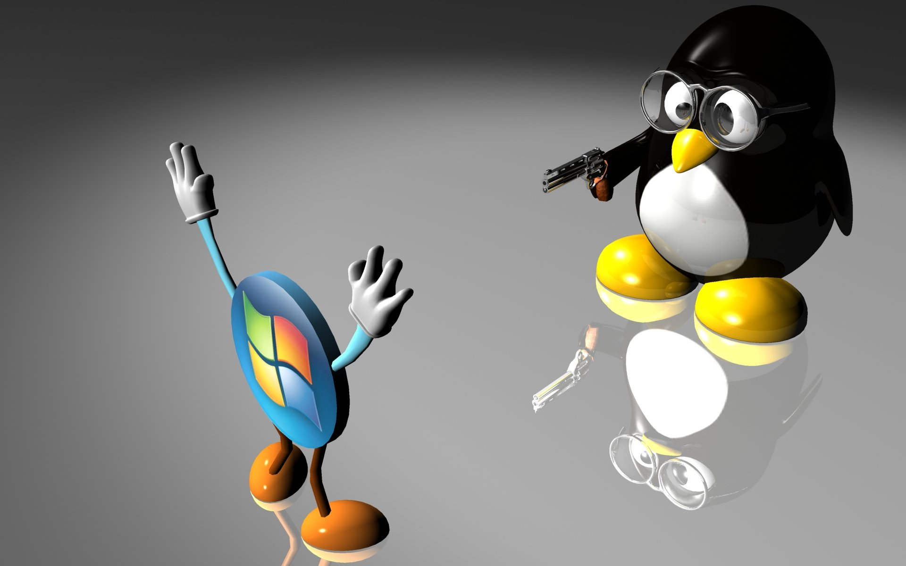

# Princípios Básicos do Linux (pt. 1)

Olá, meu nome é Sr. TeClas e eu já uso GNU/Linux faz mais de 15 anos. Todos os vídeos do canal são feitos no Linux e eu uso ele no trabalho todos os dias. E agora chegou a hora de vocês.

**Veja também no canal:**

{{#embed https://youtube.com/watch?v=HZs_G5VyQzE}}

- Já faz um tempinho que a gente vem fazendo uns tutoriais mais técnicos aqui no canal e eu meio que presumo que todo mundo usa GNU/Linux, mas eu sei que não é verdade… **e nós vamos corrigir isso**



- Essa série de vídeos é o elo perdido pra vocês aprenderem várias coisas que comentamos aqui no canal e eu resolvi dividir ela em quantas partes for necessário pra sair logo.
  - Hoje nós vamos focar na história do GNU/Linux
  - O que é um sistema operacional e o que destaca o GNU/Linux
  - Diferenças com o Windows
  - O que são “distribuições” Linux 

- O GNU/Linux, por que na realidade ele surge da junção de dois projetos (o GNU e o Linux), é um sistema operacional diferente do Windows. Se você está pensando em fazer essa migração, tenha esse fato em mente.
  - 2026 eu sinto que o Windows decaiu, o Linux popularizou, smart phones viraram comuns, tudo foi pra nuvem. Então isso não é mais um ponto de contenção
  - Mas na década de 2000 era impossível evitar a comparação 

- Entendam que é *essencial* aprender como ele funcionam para mexer no máximo de dispositivos de vocês (na realidade os sistemas **UNIX**, vamos falar da relação logo mais) 
  - O meu laptop e desktop rodam Linux
  - O meu celular roda Linux
  - A minha televisão LG roda Linux
  - O meu R36s roda Linux
  - Os meus servidores na nuvem também

- Então vamos voltar para o início e falar sobre *o que é computador*:
  - Uma máquina que faz cálculos muito rápido
  - Os cálculos podem ser programados
  - Transforme entradas em números, transforme números em saídas e badabim badabam, você tem um “computador moderno”

- O que é um sistema operacional e por que precisamos dele?

[https://pt.wikipedia.org/wiki/Sistema_operativo](https://pt.wikipedia.org/wiki/Sistema_operativo (preview))

> **Sistema operacional** é um software que gerencia os recursos de um dispositivo, como a memória e o processamento, permite a execução de programas e aplicativos, define qual programa recebe atenção do processador, cria um sistema de arquivos, e fornece uma interface entre o computador e o usuário

> Segundo Tanenbaum, pela perspectiva do usuário ou programador, existem dois modos distintos de conceituar um sistema operacional:
>
> - __numa visão de cima para baixo (*top-down*)__: é uma abstração do hardware, fazendo o papel de intermediário entre os programas (software) e os componentes físicos do computador;
>
>   ou
> - __numa visão de baixo para cima (*bottom-up*)__: é um gerenciador de recursos, i.e., que controla as aplicações (processos) a executar, como, quando e com quais recursos (memória, disco, periféricos).
>
> Um sistema operacional é projetado para ocultar as particularidades de hardware (ditas "de baixo nível") e, com sua atuação, criar uma máquina abstrata que fornece às aplicações serviços compreensíveis ao usuário (ditas "de alto nível").

- Então de novo, um sistema operacional:
  - Provê uma interface de abstração do hardware do computador: um programa escreve o valor “Tecnologia e Classe” na memória RAM, grava uma imagem no disco. Como exatamente? isso é problema do sistema operacional
  - Gerencia o acesso concorrente aos recursos: um programa pede para ler uma imagem no disco, recebe um código de sucesso ou de erro e ela é carregada na memória. Como exatamente? Isso é problema do sistema operacional

### Um breve história do GNU/Linux

- Em 1969 a AT&T Bell Labs criou o sistema operacional UNIX que posteriormente foi escrito na nova linguagem de alto nível “C”
  - Isso permitiu que ele fosse portado para diversos tipos de computadores mais facilmente
- Na época a lei antitruste dos EUA não permitiu que a AT&T Bell Labs, empresa de telecomunicação, vendendo o UNIX e ele era licenciado para universidades dos EUA
  - A simplicidade do sistema, licenciamento facilitado e a ‘filosofia do UNIX’ ajudou ele a se espalhar pelo meio acadêmico
  - É necessário entender também que o software não era visto como a mercadoria principal dessas empresas, isso viria mais tarde
- Em 1984 as empresas se desmembraram e começaram a vender o UNIX como um produto ao mesmo tempo que várias empresas começavam a comercializar estações de trabalho e servidores baseados com seus sistemas baseados em UNIX.
- Nessa mesma época  Richard Stallman cria o projeto GNU na tentativa de implementar um sistema aberto que fosse compatível com UNIX.
- O projeto chega a implementar diversas ferramentas essenciais, mas ainda fica devendo o GNU Hurd, o cerne do sistema operacional.
- Em 1987 o professor universitário Andrew Tanenbaum cria o Minix para ser um sistema operacional didático baseado em UNIX.
- Em 1990 Linus Torvalds, um estudante da Universidade de Helsinki, exposto ao Minix resolve “só por diversão” criar uma alternativa que tenha uma licença comercial e rode na arquitetura de computador 386 (o computador pessoal)
- Com o sistema ficando um pouco mais maduro ele resolve incorporar as ferramentas do projeto GNU para conseguir um sistema operacional inteiro.
  - GNU / (Linus + Unix) = GNU/Linux
- A decisão mais importante que foi feita por Linus na época foi licenciar o código do kernel como GPL. Isso criou uma comunidade de software livre e aberto em torno do projeto (e eles nunca brigaram sobre anda e continuaram felizes para sempre (ironia :) )

{{#embed https://youtube.com/watch?v=Auoe3XsWthM}}

###   
A filosofia UNIX

- O UNIX e diversos dos seus padrões (POSIX) tem uma “filosofia” de design minimalista e que com o tempo se provou muito eficiente:
  - Programas que fazem apenas uma tarefa de forma especializada (modularidade)
  - Interfaces de texto, transparentes e interoperáveis
  - Tudo são arquivos e fluxos de dados
    - Processos são arquivos, dispositivos de hardware são arquivos
    - Isso quer dizer que o código que lê um frame de um vídeo no HD, potencialmente é o mesmo código que lê um frame de uma webcam ou de um stream vindo pela rede

- Por exemplo: procurando todos arquivos do OBS na pasta atual:

```
ls OBS*
'OBS-2025-07-01 22H-48-02.mkv'  'OBS-2026-04-20 10H-34-17.mkv'  'OBS-2026-11-04 20H-45-56.mkv'  'OBS-2026-11-10 09H-25-47.mkv'  'OBS-2026-11-12 09H-39-35.mkv'  'OBS-2026-11-19 09H-33-58.mkv'  'OBS-2026-11-27 08H-15-23.mkv'
'OBS-2025-07-01 23H-17-10.mkv'  'OBS-2026-05-16 12H-12-51.mkv'  'OBS-2026-11-05 09H-33-22.mkv'  'OBS-2026-11-11 09H-51-39.mkv'  'OBS-2026-11-12 09H-39-59.mkv'  'OBS-2026-11-19 09H-37-00.mkv'  'OBS-2026-11-27 08H-16-18.mkv'
'OBS-2025-07-09 09H-38-26.mkv'  'OBS-2026-07-23 10H-10-53.mkv'  'OBS-2026-11-05 09H-34-33.mkv'  'OBS-2026-11-11 09H-52-22.mkv'  'OBS-2026-11-12 09H-40-25.mkv'  'OBS-2026-11-19 09H-37-35.mkv'  'OBS-2026-11-27 08H-37-26.mkv'
'OBS-2025-07-26 18H-35-59.mkv'  'OBS-2026-07-29 08H-45-37.mkv'  'OBS-2026-11-09 09H-30-35.mkv'  'OBS-2026-11-11 19H-51-04.mkv'  'OBS-2026-11-12 09H-56-34.mkv'  'OBS-2026-11-19 09H-37-59.mkv'
'OBS-2025-09-11 18H-23-42.mkv'  'OBS-2026-11-02 10H-19-34.mkv'  'OBS-2026-11-09 09H-31-55.mkv'  'OBS-2026-11-11 19H-57-33.mkv'  'OBS-2026-11-16 09H-11-06.mkv'  'OBS-2026-11-19 19H-31-03.mkv'
'OBS-2025-11-10 22H-52-45.mkv'  'OBS-2026-11-03 10H-04-19.mkv'  'OBS-2026-11-09 09H-42-26.mkv'  'OBS-2026-11-11 19H-59-04.mkv'  'OBS-2026-11-16 09H-16-15.mkv'  'OBS-2026-11-26 10H-29-51.mkv'
'OBS-2026-03-25 09H-37-50.mkv'  'OBS-2026-11-04 09H-35-15.mkv'  'OBS-2026-11-09 09H-42-59.mkv'  'OBS-2026-11-11 19H-59-19.mkv'  'OBS-2026-11-16 09H-17-10.mkv'  'OBS-2026-11-27 08H-08-39.mkv'
'OBS-2026-04-16 13H-03-54.mp3'  'OBS-2026-11-04 19H-33-04.mkv'  'OBS-2026-11-10 09H-24-16.mkv'  'OBS-2026-11-11 19H-59-59.mkv'  'OBS-2026-11-17 10H-46-09.mkv'  'OBS-2026-11-27 08H-14-13.mkv'
```

- Procurando todos arquivos OBS que foram gravados às 13 horas:

```
ls OBS* | grep 13H
OBS-2026-04-16 13H-03-54.mp3
```

- Um sistema POSIX geralmente virá com um conjunto de ferramentas básicas que podem ser misturadas entre si para fazer coisas incríveis: `cat`, `sed`, `grep`, `ls`, `du`, `ps`, `man`
  - GNU/Linux, MacOS (atual), BSD
  - Partes do Windows usam código e ideias do UNIX e é possível instalar um “ambiente POSIX” para trabalhar assim também no Windows (se você curte sofrer)

- Isso tudo não é só porque a gente gosta de arquivos de texto e digitar na telinha preta. Na realidade é uma maneira extremamente versátil e intuitiva de construir programas e interagir com o computador
  - É uma filosofia de design que favorece fuçadores, programadores, a customização do sistema e etc…
  - Mas em pleno 2026 isso também é mais fácil de explicar porque os agentes de IA usam quase exclusivamente texto e uma arquitetura de sistema assim é muito mais natural para trabalho com eles

> **"There is more Unix-nature in one line of shell script than there is in ten thousand lines of C."** \[[1](http://www.catb.org/~esr/writings/unix-koans/ten-thousand.html)\]

### Breve comentário sobre o sistema de arquivos

- Sabendo de tudo isso e que o Linux é um sistema baseado em UNIX, o sistema de arquivos que é montado a partir da raiz `/` é mais importante do que parece, pois ele basicamente organiza e expõe todos os componentes do seu computador

```
ls /
bin  boot  cdrom  dev  etc  home  lib  lib32
lib64  libx32 lost+found  media  mnt  opt  proc
root  run  sbin  snap  srv sys  tmp  usr  var
```

- Por exemplo:

```  
# discos
ls /dev/sd*

# cameras ou dispositivos de captura
ls /dev/video*

# processos rodando
ls /proc

# drives externos
ls /media
ls /mnt
```

- Esses não são arquivos “normais”, eles são manipulados com chamadas de leitura e escrita do sistema operacional, são representações de fluxos de dados na memória e etc…
  - Mas no geral eles se comportam como arquivos normais quando interagem com os comandos e ferramentas padrão do sistema
  - Modular, ortogonal, elegante e etc…

- Obviamente o resto do que está ali são arquivos do sistema também e dependendo do seu  sabor de GNU/Linux você terá configurações levemente diferentes disso
  - /var de dados e logs, /etc para configurações, /home para dados de usuários, /bin para executáveis … 

### O que são distribuições GNU/Linux?

- E daí estamos construindo as partes do nosso sistema operacional:
  - Linux é o kernel: drivers de hardware, gerencia acesso ao componentes, gerencia processos e uso de memória, etc…
  - Ferramentas GNU + ferramentas seguindo o padrão POSIX
  - Interface gráfica
  - Aplicativos de usuário

- As várias combinações desses diferentes componentes, empacotadas e distribuídas de uma maneira “pronta para uso” são chamadas **distribuições** ou **distros**

- Distros geralmente definem um sistema gráfico, estrutura do sistema de arquivos, um sistema de pacotes, um conjunto de pacotes prontos e um repositório para encontrá-los
  - Muitas vezes distros são construídas a partir de outras que usam padrões comuns
  - Debian → Ubuntu → Zorin OS
  - Debian → Ubuntu → Linux Mint

- Árvore genealógica das distros GNU/Linux:

[https://distrowatch.com/dwres.php?resource=family-tree](https://distrowatch.com/dwres.php?resource=family-tree (preview))

### Conclusão:

- Sim, essa foi a primeira parte da nossa série expicando o Linux.
- Os próximos episódios podem incluir uma parte mais prática demonstrando a instalação e uso do sistema
- Podemos falar sobre ferramentas comuns do dia a dia no Linux
- Podemos falar sobre usuários, arquivos, permissões, rede, interfaces de programação…
- Fica a pergunta pra vocês sobre o que gostariam

### Referências:

- Documentário sobre a história do GNU/Linux:

{{#embed https://youtube.com/watch?v=errB71uSYLc}}

- The Cathedral and the Bazaar: [http://www.catb.org/~esr/writings/cathedral-bazaar/](http://www.catb.org/~esr/writings/cathedral-bazaar/)
  - Texto clássico discutindo a maneira de desenvolver código aberto VS código proprietário e usando o Linux como estudo de caso
  - Em portugês: [http://www2.ic.uff.br/~otton/graduacao/informaticaI/catedralbazar.pdf](http://www2.ic.uff.br/~otton/graduacao/informaticaI/catedralbazar.pdf)
- The Art of Unix Programming: <http://www.catb.org/esr/writings/taoup/html/> 

- POSIX cheatsheet: <https://pubs.opengroup.org/onlinepubs/9699919799/nframe.html>

- Manual do Oreio do Bash: <https://aurelio.net/shell/>

- Consultar distribuições Linux: <https://distrowatch.com/>

- Rodar uma VM com Linux online:
  - <https://linuxcontainers.org/incus/try-it/>
  - <https://distrosea.com/>
