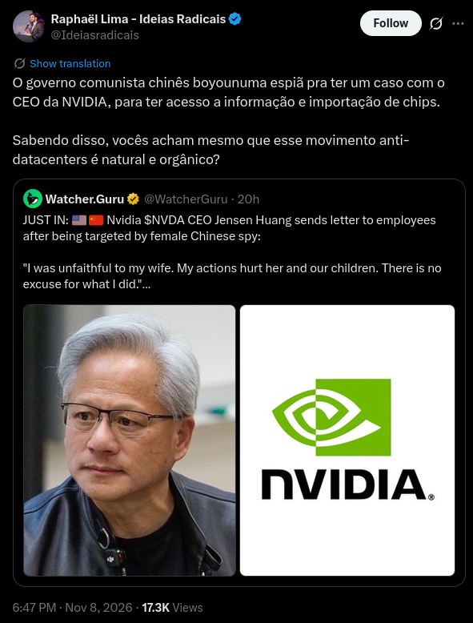

# O homem da jaqueta de couro agora foi longe demais

O CEO da NVIDIA Jensen Huang teve um caso com Alice Huang, só que ela está sendo acusada de ser uma espiã chinesa. Isso desemboca numa queda das ações da NVIDIA, investigações internas e do governo dos EUA e uma fofoquinha da boa. 

[https://timesbrasil.com.br/empresas-e-negocios/nvidia-perde-mais-de-us-330-bi-apos-ceo-admitir-caso-com-executiva-suspeita-de-espionagem/](https://timesbrasil.com.br/empresas-e-negocios/nvidia-perde-mais-de-us-330-bi-apos-ceo-admitir-caso-com-executiva-suspeita-de-espionagem/ (preview))

- A situação resumida:
  - Desde aproximadamente junho de 2024, o CEO da NVIDIA Jensen Huang, aparece próximo de Alice Huang (sem parentesco) em ambientes sociais e eventos da indústria.
  - Em 2025 eles são fotografados juntos em um jantar organizado por Jensen. Um vídeo mostra um beijinho na bochecha e eles saem do restaurante no mesmo carro
  - Em 29/10/2026 começam a sair na imprensa acusações sobre o envolvimento dos dois e sobre o papel de Alice como executiva da empresa Megaspeed e suspeitas do Departamento de Estado dos EUA de que ela seja **uma espiã chinesa**. 
  - Inicialmente Jensen nega as acusações, mas depois admite contato intimo com Alice. O board da NVIDIA anuncia que será feita uma investigação interna

> As ações da Nvidia caíram cerca de 7,5% na abertura do pregão desta segunda (9), para US$ 172,75, e a empresa perdeu mais de US$ 330 bilhões em valor de mercado.

[https://www.tomshardware.com/pc-components/gpus/nvidia-ceo-jensen-huang-admits-to-having-an-affair-with-suspected-chinese-spy-jensen-apologizes-in-letter-to-staff-company-board-forms-independent-committee-to-investigate](https://www.tomshardware.com/pc-components/gpus/nvidia-ceo-jensen-huang-admits-to-having-an-affair-with-suspected-chinese-spy-jensen-apologizes-in-letter-to-staff-company-board-forms-independent-committee-to-investigate (preview))

- Depois que a situação foi exposta o próprio Jensen Huang mandou uma carta para a empresa e para a sua família admitindo o caso:

> "Devo um pedido de desculpas à minha família e a todos vocês", escreveu Huang. "Fui infiel à minha esposa. Minhas atitudes magoaram a ela e aos nossos filhos. Não há desculpa para o que fiz. Sinto muito, profundamente. Ao longo da minha vida, minha família me deu amor e apoio. Eles merecem minha honestidade e lealdade. Em vez disso, eu os decepcionei e prejudiquei a vida que construímos juntos. Assumo total responsabilidade pelo que fiz e pela dor que causei, e aceito as críticas que surgem disso. À minha esposa e à minha família: eu amo vocês. Sei que um pedido de desculpas não pode desfazer o que fiz. Espero que nossa família consiga se recuperar e que, com o tempo, eu possa reconquistar a confiança de vocês."

- E o board da NVIDIA também largou uma declaração:

> A Nvidia rejeitou veementemente as sugestões de conduta inadequada, afirmando que seu CEO se reúne regularmente com milhares de clientes e que essas interações não envolvem informações corporativas sensíveis nem segredos de segurança nacional. Autoridades chinesas também descartaram as alegações de espionagem, classificando-as como infundadas.

- Mas depois deixou claro que seria aberta uma investigação interna.

- Pra quem não tá ligado, a NVIDIA se transformou na companhia mais lucrativa do mundo porque eles vendem “as pás para a corrida do ouro” da inteligência artificial
  - Basicamente eles são a única empresa que tá garantindo o deles e produzindo algo, mesmo que o hype desse em nada

- O Jensen Huang alimentou uma fama de bilionário genial, sempre com a sua mesma jaqueta de couro, e foi responsável pelas decisões estratégicas que posicionaram a NVIDIA como líder do uso de GPUs pra IA:
  - Criação da plataforma CUDA para computação paralela
  - Investimento em GPUs e infra focadas em IA
  - Aproximação dos laboratórios de IA antes do boom de demanda

{{#embed https://youtube.com/watch?v=BOnZkQAM_w4}}

- Isso obviamente faz dele um alvo importantíssimo de espionagem industrial e uma das pessoas que sustenta o hype da IA e o valor das ações não somenta da NVIDIA, mas das mag7 e dos futuros IPOs de OpenAI e Anthropic

- E será que ele vai perder o emprego? Depende pra caralho:
  - Por exemplo o Trump já disse: “acho que ele não sabia, ele é um cara muito honrado 🍊 “
  - Não só ele é um bilionário que pode fazer muita coisa sem ninguém pestanejar, ele tem muito crédito dentro da NVIDIA e na indústria em geral
  - Será que nesse momento a NVIDIA iria querer deixar esse cara afastado?
  - Tudo depende do nível do escândalo e profundidade do “medo da China” que existir

- Só que assim: deixem me defender o casal Alice/Jensen aqui… não foi espiã chinesa nenhuma que fez vender GPU pra China ser um negócio extremamente desejável:

{{#embed https://youtube.com/watch?v=bfI9xIyHG_E}}

- Durante os anos nós temos diversas declarações de Jensen Huang sobre o seu desejo de vender GPUs para a China:
  - “Se eles estão construindo um mercado de IA, que construam sobre uma base estadunidense”
  - Isso representa um mercado de bilhões de dólares para a NVIDIA
  - O próprio Donald Trump tirou uma casquinha com tarifas e usando a proibição/liberação como um ponto de negociação 

[https://www.tomshardware.com/pc-components/gpus/nvidias-biggest-sea-customer-exposes-the-limits-of-us-ai-export-controls](https://www.tomshardware.com/pc-components/gpus/nvidias-biggest-sea-customer-exposes-the-limits-of-us-ai-export-controls (preview))

- Isso é tão verdade que o esquema de contrabando / vista grossa da venda de GPUs NVIDIA passando por laranjas em diversos países da Asia é bem conhecido.
  - O que está acontecendo agora é a confirmação e “a merda batendo no ventilador”

- Enquanto isso no mundinho Ideias Radicais:

- Enquanto isso de 47 consultas públicas nos EUA sobre a construção de data centers, apenas 1 passou <https://ballotpedia.org/Data_center-related_ballot_measures,_2026>

- Vamos ficar de olho! Nos vemos na próxima
